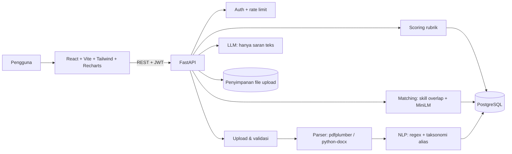
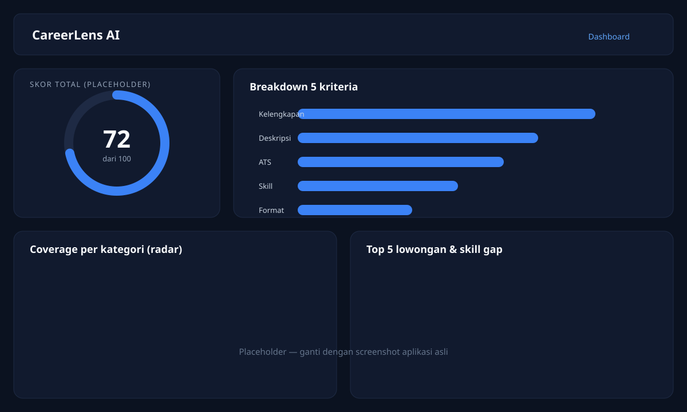
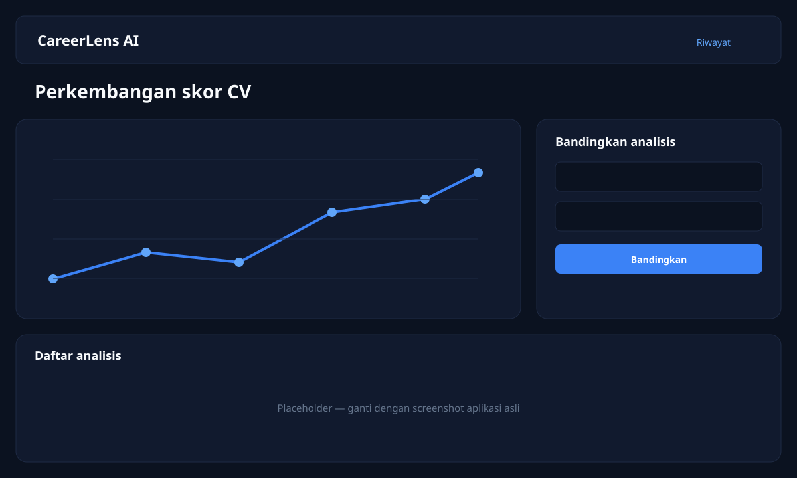

# CareerLens AI

**Your Career, Analyzed by AI.**

CareerLens AI adalah aplikasi web untuk menganalisis CV, menghitung skor
kualitas secara transparan, mendeteksi skill, menemukan skill gap, dan
mencocokkan profil dengan lowongan. Semua angka dihitung oleh kode dengan
rubrik yang dapat diaudit; LLM hanya dipakai untuk menulis saran.

> Catatan: data lowongan di aplikasi ini adalah **data fiktif** untuk demo,
> bukan lowongan pasar kerja sungguhan.

## Fitur

- Upload CV PDF/DOCX dengan validasi tipe, ukuran (maks. 5 MB), dan magic bytes.
- Ekstraksi teks, kontak, pendidikan, pengalaman, proyek, dan skill yang bisa
  dikoreksi pengguna.
- Skor CV 0–100 dengan 5 kriteria dan alasan per kriteria.
- Saran perbaikan: opsional dari LLM, dengan fallback berbasis aturan.
- Job matching: persentase kecocokan, skill cocok, skill kurang.
- Dashboard: gauge skor, bar breakdown, radar coverage, donut skill per
  kategori, top 5 lowongan, top 5 skill gap, dan saran.
- Riwayat analisis, grafik perkembangan skor, dan perbandingan dua analisis.
- Roadmap belajar dengan sumber belajar dan penanda "sudah dipelajari"
  (disimpan lokal di browser).
- Hapus CV atau seluruh akun beserta file fisik dan seluruh turunannya.

## Arsitektur



Prinsip utama: **angka dihitung kode, bukan LLM**. Skor dan persentase match
berasal dari rubrik serta perbandingan himpunan yang deterministik.

## Tech stack

| Bagian | Teknologi |
|---|---|
| Frontend | React 18, Vite, Tailwind CSS |
| Visualisasi | Recharts (lazy-loaded per halaman) |
| Backend | Python 3.12, FastAPI, Pydantic v2 |
| Database | PostgreSQL, SQLAlchemy 2, Alembic |
| Parser | pdfplumber, python-docx |
| NLP | Aturan regex + taksonomi alias (`skills.json`) |
| Matching | Sentence Transformers `all-MiniLM-L6-v2` + skill overlap |
| LLM | API kompatibel OpenAI (opsional, hanya untuk saran) |
| Testing | pytest (SQLite + embedder tiruan) |
| CI | GitHub Actions |
| Dev | Docker Compose |

## Menjalankan dengan Docker

Dari akar repo:

```bash
docker compose up --build
```

Layanan:

- Frontend: http://localhost:5173
- API: http://localhost:8000
- Health check: http://localhost:8000/health
- PostgreSQL: `localhost:5432`

API menjalankan migrasi Alembic lalu seed 40 lowongan fiktif secara otomatis.
Model embedding diunduh saat build image backend.

Untuk demo, gunakan CV fiktif di [`demo/`](demo/) dan ikuti
[`demo/README.md`](demo/README.md).

## Menjalankan secara lokal

### 1. Database

Jalankan PostgreSQL (bisa memakai service `db` dari Compose):

```bash
docker compose up -d db
```

### 2. Backend

```bash
cd backend
python -m venv venv
venv\Scripts\activate          # Windows
# source venv/bin/activate     # Linux/macOS
pip install -r requirements.txt
copy ..\.env.example ..\.env   # Windows; sesuaikan nilainya
alembic upgrade head
python -m app.db.seed_jobs
uvicorn app.main:app --reload --port 8000
```

### 3. Frontend

```bash
cd frontend
npm install
npm run dev
```

Frontend memakai `VITE_API_URL` (default `http://localhost:8000`).

## Rubrik skor CV (total 100)

| Kriteria | Bobot | Yang dihitung |
|---|---|---|
| Kelengkapan section | 25 | 5 bagian × 5 poin: kontak, pendidikan, pengalaman/proyek, skill, ringkasan. |
| Kualitas deskripsi | 25 | 50% proporsi bullet yang diawali kata kerja aksi + 50% proporsi bullet yang memuat angka/hasil terukur. |
| Keterbacaan ATS | 20 | Panjang teks yang terekstrak, heading standar, tabel, dan karakter rusak. |
| Skill & relevansi | 15 | Jumlah skill terdeteksi dan keragaman kategori. |
| Format & panjang | 15 | Estimasi 1–2 halaman, tautan GitHub/LinkedIn, dan konsistensi format tanggal. |

Setiap kriteria adalah fungsi terpisah yang mengembalikan `(skor, alasan)`.
Hasil disimpan sebagai `score_breakdown` JSON sehingga dapat ditampilkan per
kriteria. Skor tidak pernah ditentukan atau diubah oleh LLM.

## Algoritma matching

```
skill_coverage = bobot skill yang dimiliki / bobot seluruh skill lowongan
match_score    = 0.6 × skill_coverage + 0.4 × cosine_similarity
```

- Skill wajib berbobot `2.0`, skill nilai tambah berbobot `1.0`.
- `cosine_similarity` dihitung dari embedding ringkasan profil dan deskripsi
  lowongan (`all-MiniLM-L6-v2`).
- `matched_skills` dan `missing_skills` berasal dari perbandingan himpunan,
  tanpa LLM.
- `category_coverage` di dashboard memakai skill **wajib unik** dari 10
  lowongan teratas per kategori, dan mengembalikan `owned`, `total`, serta
  `percentage` agar bisa diverifikasi.

## Keputusan desain

1. **Skor oleh kode.** Rubrik deterministik dan punya unit test. LLM tidak
   boleh menghitung ulang atau menimpa angka.
2. **LLM hanya untuk saran.** Jika API key tidak tersedia atau panggilan
   gagal, sistem memakai saran fallback berbasis aturan.
3. **Anonimisasi PII sebelum LLM.** Nama, email, telepon, URL profil, dan
   tautan pribadi diredaksi sebelum prompt dikirim.
4. **Ownership ketat.** Setiap endpoint data memfilter `CV.user_id`; akses
   lintas pengguna menghasilkan 404.
5. **Hapus berarti hapus.** Hapus CV/akun menghapus baris database, turunan
   analisis, job match, dan file fisik.
6. **Grafik dari data nyata.** Dashboard tidak menampilkan persentase "level
   skill" yang tidak diukur sistem.

## Test

Dari `backend/`:

```bash
pytest -q                     # semua test cepat (embedder tiruan)
pytest tests/test_scoring.py -q
pytest -m slow -q             # memakai model sentence-transformers asli
```

Test memakai SQLite in-memory, `bcrypt_rounds=4`, dan embedder tiruan agar
cepat serta tidak mengunduh model. Frontend:

```bash
cd frontend
npm run build
```

CI GitHub Actions menjalankan `pytest -q` dan `npm run build` pada setiap push
dan pull request.

## Struktur folder

```
careerlens/
├─ .github/workflows/ci.yml
├─ backend/
│  ├─ alembic/                 migrasi database
│  ├─ app/
│  │  ├─ api/                  router auth, cv, profile, analysis, jobs, skills, dashboard
│  │  ├─ core/                 config, security, rate limit
│  │  ├─ models/               model SQLAlchemy
│  │  ├─ schemas/              skema Pydantic
│  │  ├─ services/             parser, nlp, scoring, matching, llm
│  │  └─ data/                 skills.json, jobs_seed.json, learning_resources.json
│  ├─ tests/                   pytest + fixtures
│  └─ requirements.txt
├─ demo/                       CV fiktif DOCX/PDF + instruksi demo
├─ docs/                       rancangan, rencana kerja, audit keamanan, screenshot
├─ frontend/src/               halaman, komponen, API client
├─ docker-compose.yml
├─ .env.example
└─ LICENSE
```

## Screenshot

Placeholder tersedia di [`docs/screenshots/`](docs/screenshots/). Ganti dengan
tangkapan layar asli setelah menjalankan aplikasi.





## Keamanan dan privasi

- `ENVIRONMENT=production` menolak start jika `JWT_SECRET` masih nilai contoh
  atau kurang dari 32 karakter, atau `CORS_ORIGINS` berisi `*`.
- Rate limit `/auth/login` dan `/auth/register` per IP (default 10/menit).
- Pesan gagal login generik; tidak ada PII di log aplikasi.
- File upload divalidasi ekstensi, MIME, magic bytes, ukuran, dan isi kosong.
- Detail audit dan tabel ownership: [`docs/security-audit.md`](docs/security-audit.md).

## Batasan

- **Lowongan adalah data fiktif.** Seed 40 lowongan dibuat untuk demo, bukan
  daftar lowongan nyata dan tidak mencerminkan pasar kerja terkini.
- **Parser berbasis aturan.** Alias section dan regex bisa meleset pada format
  CV yang tidak umum, kolom rumit, atau PDF hasil scan tanpa teks. Hasil review
  pengguna tetap diperlukan.
- **Skor adalah heuristik.** Skor 0–100 adalah alat bantu perbaikan, bukan
  penilaian HR, keputusan rekrutmen, atau jaminan lolos ATS.
- **Model semantik berbahasa Inggris.** `all-MiniLM-L6-v2` lebih kuat untuk
  teks Inggris; nuansa bahasa Indonesia bisa kurang tertangkap.
- **Rate limit in-memory.** Batas berlaku per proses; deployment multi-worker
  perlu Redis atau penyimpanan bersama.
- **Embedding disimpan sebagai JSON.** Belum memakai pgvector/ANN indexing,
  sehingga pencarian lowongan masih memindai seluruh kandidat.
- **Tanpa pemindaian malware.** Validasi file mencakup tipe/ukuran/format,
  bukan antivirus.

## Lisensi

MIT — lihat [LICENSE](LICENSE).
